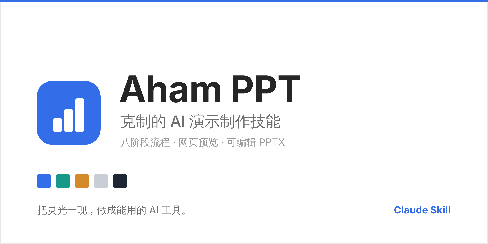
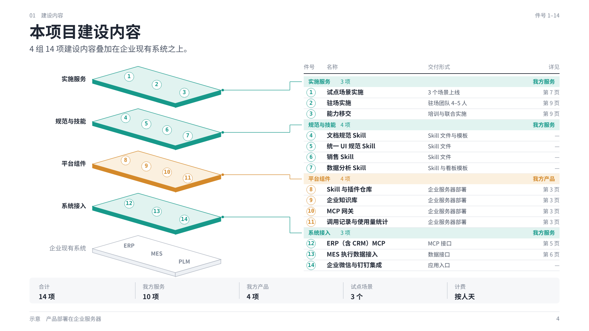
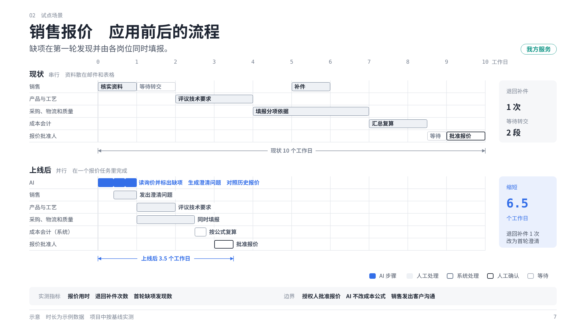
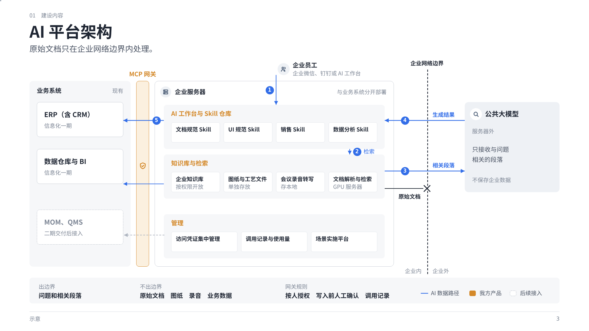
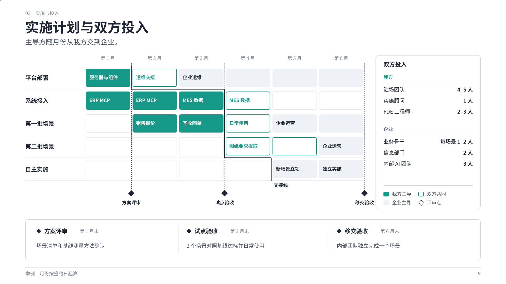

# Aham PPT

[](https://github.com/Aham-AIAPP/aham-ppt/releases)
[](LICENSE)
[](#)
[](assets/wechat-qr.png)



Aham PPT 是一个 Claude 技能，把零散材料做成方案级、汇报级的 PPT。
技能按八个阶段推进：先定受众和论点，再定页面结构，最后写页面并检查。
页面写成 HTML 幻灯片，网页预览确认后导出可编辑 PPTX。

## 适用文稿

- 给客户看的售前方案、项目方案和整体规划方案。
- 给管理层看的汇报和报告。
- 需要逐页论证、数字有出处、版面统一的其他文稿。

## 八个阶段

| # | 阶段 | 产出 |
| --- | --- | --- |
| 1 | 受众与规范 | 受众卡、色表、术语表、检查配置 |
| 2 | 材料解析 | 带出处的信息清单。脚本先把材料转成提纲，只读相关章节 |
| 3 | 论点提炼 | SCQA 和一句话核心结论 |
| 4 | 叙事骨架 | 标题序列，经过五项测试 |
| 5 | 页面规划 | 每页的内容结构和图形设计 |
| 6 | 样页确认 | 4 至 5 页不同结构的样页，导出并检查后请用户确认 |
| 7 | 逐页设计 | 全册页面，每页填七项自查表，每章确认一次 |
| 8 | 质检交付 | 机器检查、人工检查、PPTX 和预览页 |

每个阶段输出完成卡，用户确认后进入下一阶段。

## 风格的三层

| 层 | 文件 | 约束 |
| --- | --- | --- |
| 固定数值 | [`style-tokens.md`](references/style-tokens.md)、[`components.js`](assets/html2pptx/components.js) | 字号、颜色、线宽、圆角、页面框架全册不变 |
| 元素 | [`style-elements.md`](references/style-elements.md) | 每种元素表达一种关系：件号气泡、流程序号、尺寸线、评审点、图表、图标等 |
| 构图 | [`design-principles.md`](references/design-principles.md)、[范例库](assets/examples/README.md) | 先判断本页内容的结构，再为这个结构设计图形 |

颜色只用灰阶和三个语义色：蓝表示 AI，青绿表示我方服务，橙表示我方产品。

## 范例

范例库收了 10 页合格页和 5 页不合格页，各附手法说明或问题说明。

<table>
<tr>
<td width="50%"><br><sub>部件与装配：叠板图加件号明细</sub></td>
<td width="50%"><br><sub>时间压缩：双泳道加尺寸线</sub></td>
</tr>
<tr>
<td width="50%"><br><sub>边界与穿越：分区图加拦截叉</sub></td>
<td width="50%"><br><sub>主导方交接：矩阵加评审点</sub></td>
</tr>
</table>

## 检查

| 脚本 | 对象 | 查什么 |
| --- | --- | --- |
| `check_slides.js` | 网页幻灯片 | 字号、溢出、越界、重叠、导出兼容；文字越框、压线、对比度、箭头标签、单名称方框、空白 |
| `check_deck.py` | 导出的 PPTX | 最小字号、逗号分句、禁用词、页码引用、内部编号、术语、价格说法、标题形式、颜色和图例 |

机器检查之外，阶段 8 按叙事、文字、版式、交付四层做人工检查。方案类另有 22 项检查清单，每项附实际出过的错误。

## 开始使用

把仓库地址 `https://github.com/Aham-AIAPP/aham-ppt` 发给 Claude，请它安装技能；或下载仓库后把技能文件上传给 Claude。
安装后对 Claude 说「帮我做 PPT」或「做客户方案 PPT」。

导出 PPTX 需要 Node.js，首次使用时在 `assets/html2pptx/` 运行 `npm install`。检查脚本需要 Python，运行 `pip install -r requirements.txt`。

## 文件结构

```
SKILL.md                    技能入口：阶段与文件、按条件读的文件、规则优先级
references/
  phase-common.md           阶段共用的动作、完成卡、工作区文件
  phase-01.md … phase-08.md 八个阶段
  coach-engine.md           档位检测和引导序列
  wording-rules.md          用词规则
  solution-deck.md          方案类 PPT 的结构、版式和检查清单
  design-principles.md      七条版式原则、内容结构与画法
  style-tokens.md           固定数值
  style-elements.md         元素、图表、图标
  html-slides.md            网页幻灯片写法、组件、命令
assets/
  html2pptx/                组件库、预览、检查、导出；demo/build.js 是五页示例
  tools/                    材料提纲脚本、PPTX 检查脚本
  examples/                 范例库
```

## 更新记录

[Releases](https://github.com/Aham-AIAPP/aham-ppt/releases) · [CHANGELOG](CHANGELOG.md) · [CONTRIBUTING](CONTRIBUTING.md) · [MIT](LICENSE)

## 关于 Aham

Aham 来自 *aha moment*。每个工具只做好一件事。

| 应用 | 用途 |
| --- | --- |
| [Aham UI](https://github.com/Aham-AIAPP/aham-ui) | 供 AI 使用的设计系统 |
| [Aham Word](https://github.com/Aham-AIAPP/aham-word) | 供 AI 使用的 Word 规范 |
| [Aham Survey](https://github.com/Aham-AIAPP/aham-survey) | 现场调研工具（macOS） |
| [Aham Voice](https://github.com/Aham-AIAPP/aham-voice) | 录音转写与会议纪要（macOS） |
| **Aham PPT** | 把材料做成方案级 PPT 的技能 |

来源与脱敏说明见 [`ORIGIN.md`](ORIGIN.md)。

### 关注与交流

公众号发布 AI 工具的实践和更新，也欢迎扫码加作者微信交流。

<p></p>
